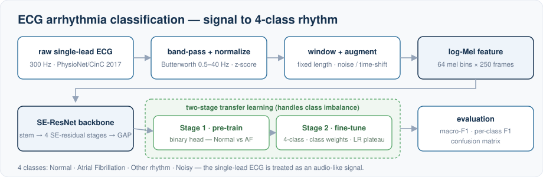
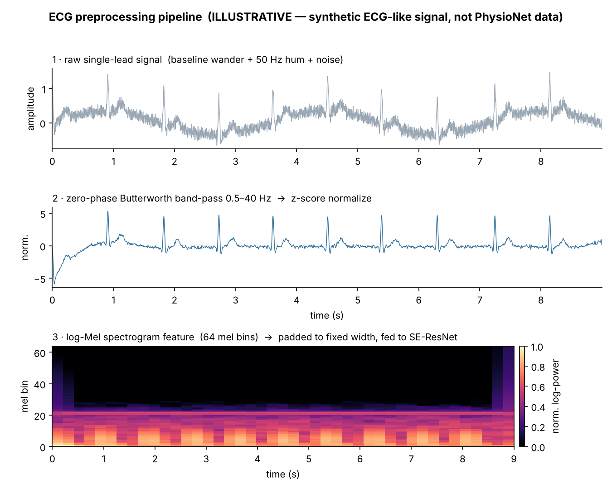
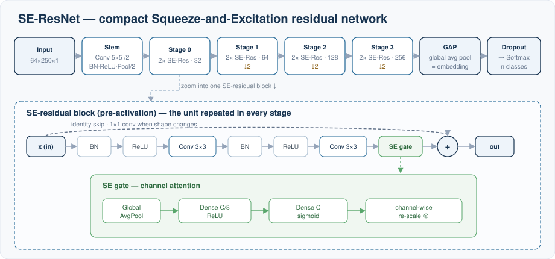

# ECG Arrhythmia Classification — SE-ResNet + Transfer Learning

A 4-class **ECG rhythm classifier** for the **PhysioNet/CinC 2017** task
(Normal / Atrial Fibrillation / Other / Noisy). The single-lead ECG is treated
as an audio-like signal: band-pass filtering → **log-Mel features** → a
**Squeeze-and-Excitation ResNet**, trained with a **two-stage transfer-learning**
schedule (binary pre-train → 4-class fine-tune) to handle class imbalance.

> Uses only the **public** PhysioNet 2017 dataset — **no data is included in this
> repository.**

## Approach



The raw single-lead ECG is band-pass filtered and normalized, turned into a
fixed-size log-Mel image, and classified by an SE-ResNet trained in two transfer
stages (binary Normal-vs-AF pre-train, then a 4-class fine-tune with class
weights).

## Preprocessing example



*Illustrative only — generated from a **synthetic** ECG-like signal (periodic QRS
+ baseline wander + 50 Hz hum + noise), not PhysioNet patient data. The figure is
produced by this repository's actual `preprocessing.py` (`bandpass_filter` →
`normalize` → `log_mel`): the band-pass removes baseline wander and mains hum, and
the per-beat structure appears as vertical bands in the low mel bins.*

## Model architecture



A conv stem, four residual stages with a Squeeze-and-Excitation gate on every
block, global average pooling (the reused embedding), and a softmax head. The SE
gate is lightweight channel attention: squeeze with global average pooling, excite
through a small bottleneck MLP, then re-scale the channels.

## Project structure

```
src/
├─ preprocessing.py   # band-pass filter, normalization, log-Mel features, augmentation
├─ seresnet.py        # Squeeze-and-Excitation residual network (Keras functional API)
├─ dataset.py         # load PhysioNet records + labels, build tf.data pipelines
├─ train.py           # two-stage transfer-learning training (CLI)
└─ evaluate.py        # load a model, report macro-F1 + confusion matrix
requirements.txt
```

- **preprocessing.py** — turns a raw 1-lead ECG into a fixed-size log-Mel image:
  zero-phase Butterworth band-pass, z-score normalization, fixed-length
  windowing, log-Mel spectrogram, plus optional noise / time-shift augmentation.
- **seresnet.py** — a compact SE-ResNet: a conv stem, four residual stages with a
  Squeeze-and-Excitation gate per block, global average pooling and a softmax
  head. Includes a helper to swap the head for the transfer-learning stage.
- **dataset.py** — reads the `.mat` records and `REFERENCE.csv` labels, splits
  train/validation, and builds `tf.data` pipelines (with feature caching).
- **train.py** — stage 1 pre-trains a binary backbone (Normal vs AF); stage 2
  replaces the head and fine-tunes on all 4 classes with class weights,
  `ReduceLROnPlateau`, early stopping and checkpointing.
- **evaluate.py** — loads a saved model and reports macro-F1, per-class F1 and a
  confusion matrix.

## Quick start

```bash
pip install -r requirements.txt

# 1) Download the public training set (training2017.zip) from PhysioNet/CinC 2017
#    and unzip so that <data_dir> contains A00001.mat ... and REFERENCE.csv

# 2) Train (stage 1 binary pre-train -> stage 2 four-class fine-tune)
python -m src.train --data_dir <data_dir> --epochs 40 --batch_size 64

# 3) Evaluate
python -m src.evaluate --data_dir <data_dir> --model_path runs/best_4class.keras
```

## Tech stack

Python · TensorFlow/Keras · librosa · SciPy · scikit-learn · NumPy · pandas

## License

See [`LICENSE`](./LICENSE) — shared for evaluation purposes only.
